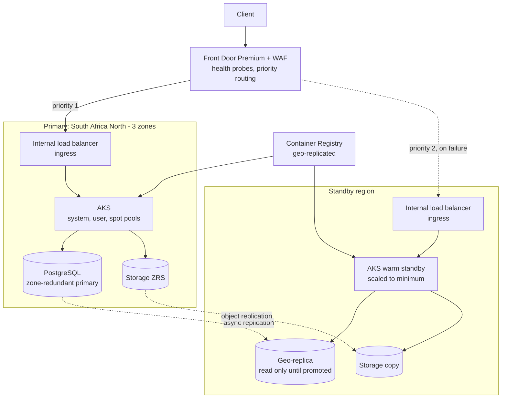
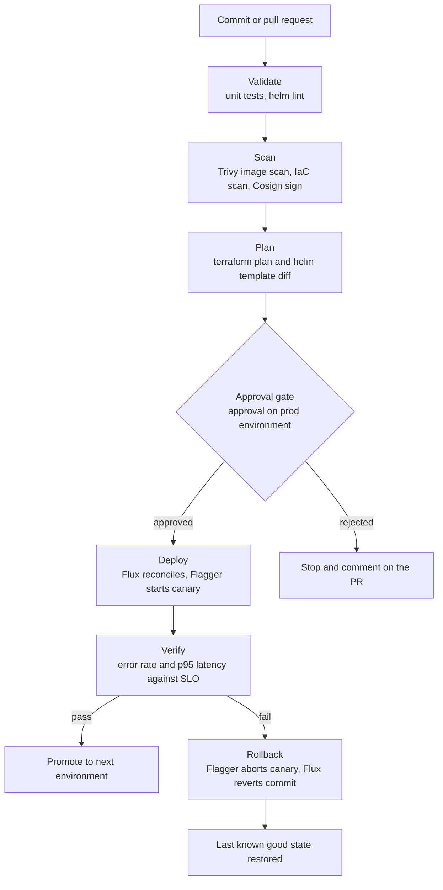
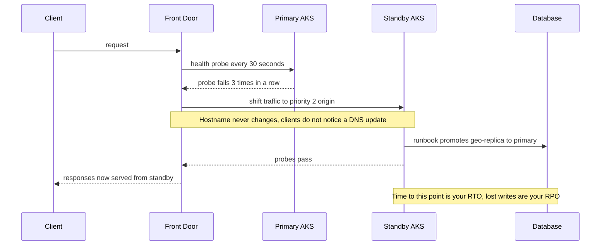

# Resilient AKS Payments Platform

A zone-redundant AKS platform in South Africa North with a warm standby region, health-based failover through Front Door, and GitOps releases that roll back on their own.

### Business use case

A fintech or e-commerce payments API that cannot go down at month-end or on Black Friday, and must keep its primary data in South Africa. The business pays for it because an hour of downtime costs more than the platform.

### The hard piece

Multi-region failover with measured RTO and RPO

### Rough monthly cost, ZAR

R600 to R1,500 a month with teardown. Two regions always on is closer to R3,000 to R4,500. Keep the standby scaled to the minimum and use a spot pool for stateless pods.

### Tool stack

- AKS (system, user and spot pools)
- Availability zones 1-3
- Cluster autoscaler + KEDA
- Flux or Argo CD
- Flagger (canary)
- Helm
- Container Registry geo-replication
- Front Door Premium + WAF
- PostgreSQL Flexible Server (zone-redundant HA + geo-replica)
- Key Vault CSI driver
- Workload Identity
- Managed Prometheus + Grafana
- Chaos Studio
- Trivy + Cosign
- GitHub Actions + OIDC
- Terraform
- k6

### Diagrams

#### Diagram 1 · Architecture: primary region and warm standby

> **How to read this:** Client traffic always enters through Front Door. While the primary passes its health probe, 100% of requests go to the solid line. The dotted lines show data moving to the standby in the background, which is why failover costs a little data (RPO) and some minutes (RTO) that you will measure in a game day.

#### Diagram 2 · CI/CD: build, sign, canary, roll back

> **How to read this:** Follow the top line from a commit to a deploy: the pipeline stops at the first red step, and nothing reaches the approval gate unless validation, scanning and the plan all passed. The bottom branch is the one hiring managers ask about: when verification fails, the rollback box puts the environment back without a human editing the console.

#### Diagram 3 · Hard piece: region failover game day

> **How to read this:** Read it top to bottom as time passing. Front Door detects the failure on its own, but promoting the database is a deliberate step in a runbook, and that gap is where the real recovery time lives. Run it as a game day, record the clock, and publish the numbers.

### How it covers the five focus areas

- **Compute · HOME**: Three node pools (system, user, spot), pod topology spread across zones, PodDisruptionBudgets, cluster autoscaler plus KEDA scaling on queue depth, spot pool for stateless work only.
- **Networking** (deep): Private cluster, Azure CNI Overlay, internal load balancer behind Front Door Private Link, NetworkPolicy, WAF rules, egress through a firewall or NAT gateway.
- **Storage** (deep): Zone-redundant database with a cross-region geo-replica, ZRS storage with object replication, Velero backups to blob, restore tested in the game day.
- **CI/CD · HOME**: Build, scan, sign and push from GitHub Actions; Flux pulls the desired state; Flagger runs the canary and judges it against Prometheus metrics; rollback needs no human.
- **Cost optimisation** (deep): Spot pool, standby scaled to minimum, nonprod cluster stop and start on a schedule, right-sized requests, a reservation analysis for the steady baseline.
### Advanced features that show depth

- Flagger canary gated on an SLO query, not on a timer
- Chaos Studio experiments: kill a zone's nodes, then a whole pool, and watch the SLO
- Burn-rate alerting on the error budget instead of CPU thresholds
- Image signing with Cosign and an admission policy that rejects unsigned images
- Failover game day with a published RTO and RPO and a lessons-learned page

### Production-like touches

- Written SLOs with an error budget policy
- k6 load test results committed next to the code
- Runbook: fail over, then fail back
- Post-incident write-up of the game day: what broke, what the timer showed
- Dashboards for golden signals, plus an on-call alert route

### AWS to Azure bridge

| AWS | Azure | Where it trips up AWS engineers |
| --- | --- | --- |
| EKS | AKS | The control plane is free on the Free tier; the paid tier adds an SLA. A second resource group (MC\_...) is created for nodes. Do not edit it by hand. |
| Route 53 failover + ALB | Front Door (global L7) or Traffic Manager (DNS) | Front Door is an anycast edge with WAF built in. Traffic Manager only answers DNS, so clients can cache the old answer. |
| ECR replication | Container Registry geo-replication | Geo-replication needs the Premium tier. |
| IRSA | Workload Identity | A federated credential on a managed identity, mapped to a Kubernetes service account. |
| Karpenter | Cluster autoscaler or node auto-provisioning | Node auto-provisioning is Karpenter-based. Check it is available for your version. |
| RDS Multi-AZ + cross-region replica | PostgreSQL Flexible Server HA + geo-replica | Zone-redundant HA is in-region; the geo-replica is a separate promotion step. |

### Résumé pitch

- Built a zone-redundant AKS platform with warm-standby failover; measured RTO of \[N\] minutes and RPO of \[N\] seconds in a documented game day.
- Implemented GitOps canary releases with Flux and Flagger gated on SLO metrics, reducing failed-release impact to \[N\]% of traffic.
- Lowered compute cost by \[N\]% with spot node pools and a minimum-size standby region while holding a \[N\]% availability target.

> *Replace every \[N\] with a number you measured. If you cannot measure it, remove the claim.*
